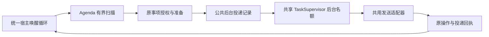

# CORE-04/08 后台协调与提醒投递

日期：2026-09-23。提醒已从本地准备接入统一宿主的后台任务、共用 sender 和持久投递回执。新增运行基础可供其他领域注册投递 owner。验证使用临时 V2 数据和替身发送器；本批没有启动在线 profile、调用真实模型或向平台发送消息。

## 运行链路



`CompanionApplication` 显式装配 `agenda`、`agenda_background`、`outbound` 和 `background`。对话仍使用原前台任务和分段顺序；新后台协调器只领取自己登记的投递任务，不领取日记或工具子任务。日记调度、提醒和对话共用宿主唤醒、运行代和停机入口，任务并发统一由监督器约束。

- `agenda/background.py`：扫描、过期策略、精确私聊接收者、来源复核及授权状态查询。
- `delivery/models.py`：对话与后台共用的 envelope、sender 和 receipt 合同。原 `conversation.delivery` 导入路径保留兼容导出。
- `delivery/service.py`：注册领域 owner、创建不可变投递意图、原操作、已派发/未知恢复及回执核对。owner 提供按原引用授权读取正文的回调。
- `host/background.py`：有界规划、后台精确领取、容量等待、句柄跟踪及停机；不自建线程、Cron 或另一套任务租约。

普通空闲轮询上限为一秒；完整扫描页之间主动让出事件循环。默认每页 16 个事项，当前配置允许 1–32。扫描游标及每期处理结果持久保存：无权事项记为 blocked 并继续扫描；队列满时回滚该期准备、下一期登记和任务提交，沿游标检查后续事项，再在后续轮询重查容量。执行器没有领取到名额时不会立即自唤醒。一个 scope 的在途提醒不会阻挡其他 scope 使用剩余后台名额。

## 停机后的时间策略

默认允许晚到 300 秒，参数由可信宿主装配传入 `AgendaDispatchPolicy`，不是管理页面配置。队列任务的原截止时间持久保存，重启不刷新。

过期独立提醒记为 skipped；重复事项根据原日历锚点直接计算下一有效期次，不逐条生成停机期间的历史提醒。最近一期仍在允许时间内才会排队，否则只登记未来期次。一次性过期提醒不再补发。关联便签过期后保留“等待便签完成”，不据此修改便签状态、完成次数或序号。

日期跳转保留日/周/月/年、间隔、次数和原时区。需要解决的夏令时缺失时间和日历越界留下明确原因，不猜一个替代时间。重复调用原期次登记不会创建第二个预约。

## 身份、版本与效果

当前只发送创建者本人在原完整私聊内的提醒。管理员替别人建立的记录、群范围、不完整路由或缺少当前授权的记录不会被转发到某个“最近窗口”。TaskSupervisor、Agenda 对象权限、原账号/人格绑定及 sender 的宿主授权各自复核，不自动增加 grant。

投递意图只保存原 context、期次及准备版本、内容哈希、sender 和时限；不复制便签正文。排队、领取、执行以及原生 sender 的 `before_dispatch` 边界均重新读取和校验原件。改期、取消、完成、删除、正文更正、角色换走又换回、身份换绑或撤权都会使旧稿失效。已经排队后被更正的原期次不会偷偷生成第二个任务；需要明确重新安排时使用原领域的改期入口。

本地登记、prepared、queued、accepted、delivered、failed 和 unknown 分别保留。只有可信 delivered 回执及平台引用证明送达；not_sent 归为已知失败。accepted 不等于送达。已开始而未知的发送不自动重放，重复扫描或重启不能换任务 ID 重做同一期。未来的独立重复期次仍是原预约中的另一逻辑事项。

迟到回执可以在撤权或停机排空期间记入原效果账本，不重读私人正文，不恢复任务、不再发送。`application.reconcile_delivery` 可在当前授权和原 worker 停止证据成立后，将已知回执归入原任务；原操作、origin、payload、sender、时间与已确认结果冲突均拒绝。后台实际发送回执位于公共投递账本，尚不进入普通对话的已发历史表。

后台任务的句柄加入 `active_handles`。停机先关闭调度和入口，再有界等待/取消执行；不响应取消的 sender 仍占有名额并保持数据库可用，直到实际停止。启动先恢复公共任务及已派发投递，再开放调度。旧运行代不能继续提交扫描、任务或效果。

授权查询入口为 `application.agenda_background.observe(actor, target=..., occurrence_id=..., observed_at=...)`，返回排程、任务/投递状态和回执引用，不含正文。原“创建提醒成功”操作回执仍描述当时本地登记，不能被改写成后来已送达。

## 存储与验证

V2 内部 schema v18 → v19 新增 `background_deliveries`、`background_delivery_receipts`、`agenda_dispatches`。游标复用 V2 metadata。迁移在同一事务校验表形状、完整性及历史指纹；失败回滚，部分未来表或被篡改的迁移回执拒绝打开。既有 V1–V18 的内部升级指纹不变，没有读取或迁移生产 V1 数据。

新增 28 项测试；相关验证去重后共 **275 个测试 ID 通过**。分组为：提醒/权限/工具及新迁移 80 项；宿主、日记并发、管理路由及隔离 83 项；全部存储模块 84 项；AstrBot bootstrap 与 native 32 项。新迁移 4 项出现在第一组和存储组中，不重复计数。历史存储首次运行中有 5 处迁移总数断言仍为 17，更新为 v19 的 18 次后，受影响 32 项复验通过；其余存储测试已通过，不重复全量运行。

主要命令（AstrBot 自带 Python，UTF-8）：

```powershell
& 'C:/Users/99505/.astrbot/backend/python/python.exe' -X utf8 -m unittest tests.test_agenda_background tests.test_background_delivery_storage tests.test_agenda tests.test_agenda_access tests.test_agenda_tools -q
$env:PYTHONPATH = 'C:/Users/99505/.astrbot/backend/app'
& 'C:/Users/99505/.astrbot/backend/python/python.exe' -X utf8 -m unittest tests.test_host_application tests.test_host_recovery tests.test_host_external_tools tests.test_role_life_host tests.test_role_journal_host tests.test_role_journal_scheduling tests.test_role_journal_triggers tests.test_astrbot_staging_host tests.test_relationship_management_host tests.test_isolation -q
& 'C:/Users/99505/.astrbot/backend/python/python.exe' -X utf8 -m unittest discover -s tests -t . -p 'test_*storage*.py' -q
& 'C:/Users/99505/.astrbot/backend/python/python.exe' -X utf8 -m unittest tests.test_astrbot_staging_bootstrap tests.test_astrbot_native -q
```

这完成的是当前私聊文本提醒的运行链路和公共后台投递基础。生产宿主全量接入、发送现场验收、任务/回执保留归档、跨领域已发表达历史、主动偏好与免打扰、群聊/转述、媒体及 V1 迁移仍有后续工作，整个插件还不能标为可直接替换发行。
