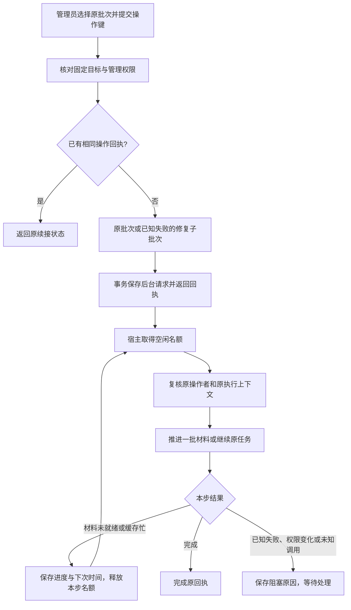

# V2 记忆：显式修复的持久后台续接

日期：2026-09-24。接续[分批反思准备](CORE_MEMORY_REFLECTION_SELECTION_20260924.md)。本批已落入 V2 主树，使用临时数据根、合成消息和本地模型替身完成定向验收。

## 问题与结果

此前管理接口只执行一次 `run()`。冷索引尚未准备完成时会返回 `selecting`；每日日程能够继续唤醒，但手动修复缺少持久执行意图，需要客户端再次提交。

现在管理员可一次登记原批次的后台续接。接口保存请求后返回，宿主按原唤醒循环推进材料准备、模型整理和本地提交。请求不依赖 HTTP 连接或页面存活；重启后继续同一请求。旧的同步 `/reflections/retry` 接口保持兼容，新页面应使用 `/reflections/queue`。



## 执行与恢复规则

- 只有显式提交的新请求进入后台队列。升级和启动不会把历史 `prepared` / `selecting` 批次自动登记为新请求。
- 请求保存原完整 `TaskContext` 和独立管理员身份；每次后台推进重验操作者的管理权限、原会话归属和运行代。管理员不会成为记忆主体。模型派发、运行和提交继续由原角色任务验证当前来源、配置及授权。
- 已准备、已收到输出、已解析、已完成的批次沿用原材料或结果。已知失败通过现有修复合同创建子批次，自动格式修复仍最多一次；不扩大到新聊天或新 pending 提案。
- 停机取消工作协程并保留请求；重启遇到原模型调用结果未知时标为 `blocked`，不重放。已保存输出继续本地解析或写入。
- 相同管理员、上下文、原批次及操作键对应同一请求。旧请求失败后重复提交只返回原回执；再次明确修复使用新操作键。不同操作键指向同一批次时，原模型任务仍负责去重。
- 缓存忙或任务存储暂满时保留请求，5 秒后再推进；正常分批准备间隔 1 秒。占满名额时依靠完成通知唤醒，避免到期记录导致空转。
- 请求与日程共用记忆后台名额，模型执行仍通过公共 `TaskSupervisor`。所有领域的全局公平排队不在本批范围。

`queued` 表示后台请求尚未结案，可能正在准备、等待或运行；实际阶段以批次的 `state` / `selection` 为准。`blocked` 不表示原材料已删除，也不授权自动重做。

## 管理 API

单目标前缀为 `/astrbot_plugin_private_companion_v2/memory`。多目标使用宿主目录返回的固定 `memory_api`，同一合同自动注册到各私聊 target/role；群目标不因此获得私聊记忆入口。

```http
POST <memory_api>/reflections/queue
Content-Type: application/json

{"batch_id":"原批次 ID","operation_key":"本次明确操作的唯一键"}
```

返回 `job_id`、实际执行的 `batch_id`、`state`、`next_at`、`result_code` 和创建/更新时间，不等待模型。失败修复可能返回子批次 ID，应保存这个实际 ID。

通过 `GET <memory_api>/reflections?batch_id=<返回的 batch_id>` 查看进度。新增 `continuation` 字段提供该批次最近登记的续接状态；既有 `selection`、`repair_batch`、`retry_of` 和逐项回执保持原用途。自动修复子批次可沿 `repair_batch` 查看。重交相同 POST 也可读取该操作自身的持久回执，不创建新调用。

队列端点只接受 `batch_id` 与 `operation_key`；操作者、账号、角色和会话来自登录身份及固定宿主目标。额外身份字段、查询参数覆盖、重复 JSON 字段、非法编码及超限请求沿用严格校验。管理响应不返回模型原始文本、操作者身份 JSON 或原文清单。

宿主停止时不接纳新请求；既有回执在仍有数据根且管理员有效时可查询。新接口已通过真实 SDK 的绑定请求上下文验收，页面按钮尚未接入。

## 数据与文件归属

V2 主库从 **v27 升至 v28**，新增 `memory_reflection_jobs`。按状态和下次时间索引查询到期请求，按原批次索引查回执，不循环解码历史反思记录寻找手动任务。升级只建表和索引，不回填执行意图；非空历史批次与占用关系保留。升级失败整体回滚并可重试，回执指纹和不完整升级继续校验。

- `companion_v2/memory/reflection_jobs.py`：持久请求、逐步执行、失败状态、唤醒与停机。
- `reflection_management.py`、`scheduling.py`、`reflection.py`：管理登记、宿主装配与批次状态投影。
- `astrbot_host/memory_api.py`：登录身份和固定管理目标下的异步登记接口。
- `companion_v2/storage/reflection_job_schema.py`、`schema.py`、`runtime.py`：v28 表、索引和升级。
- `tests/test_memory_reflection_jobs.py`、`test_memory_job_migrations.py`、`test_memory_jobs_multi_host.py`、`test_memory_host_api.py`：续接、迁移、隔离及 SDK 请求验收。

## 定向验证

按测试 ID 去重 **179 项最终均有通过记录，其中新增 20 项**：后台续接 14 项、v28 升级 3 项、SDK 队列 API 2 项、多目标实际路由 1 项。重复执行不累计数量。

| 验证范围 | 结果 |
| --- | --- |
| 已有选材、迁移与宿主分批 | 29 项通过，其中 8 项在最终反思组再次覆盖 |
| 新续接、升级、反思、修复队列、启动恢复与分批宿主 | 83 项通过 |
| 历史存储升级、执行/模型/会话存储与隔离 | 38 项通过 |
| SDK 记忆 API、staging、多目标路由及多目标宿主 | 37 项中 36 项初次通过，1 项夹具修正后单项通过 |

早期专项有两项夹具问题：日期字符串未使用统一微秒格式；API 测试只发布来源，未产生可反思的会话输入。多目标夹具随后因传入的人格提示与 SDK 绑定不一致，被拒绝为 `model_not_started`；改用实际人格提示后通过。原失败日志保留，没有放宽权限、人格绑定、模型调用次数或超时断言。

覆盖一次登记后分批完成、同操作重放、不同操作共用原模型任务、已知失败的新操作修复、原管理员撤权、记忆关闭、冷索引重启、缓存忙、已保存输出续写、运行中取消与未知不重放、外层事务回滚，以及多 Bot/角色越界拒绝和路由注销。

复验使用 AstrBot 自带 Python。宿主组设置 `PYTHONPATH=C:/Users/99505/.astrbot/backend/app`，SDK 导入的数据根由夹具指向临时目录。

```powershell
& 'C:/Users/99505/.astrbot/backend/python/python.exe' -X utf8 -m unittest -v `
  tests.test_memory_reflection_jobs tests.test_memory_job_migrations `
  tests.test_memory_reflection tests.test_memory_recovery tests.test_memory_recovery_queue `
  tests.test_memory_startup_recovery tests.test_memory_selection_host

$env:PYTHONPATH = 'C:/Users/99505/.astrbot/backend/app'
& 'C:/Users/99505/.astrbot/backend/python/python.exe' -X utf8 -m unittest -v `
  tests.test_memory_host_api tests.test_memory_jobs_multi_host `
  tests.test_astrbot_staging_host tests.test_astrbot_multi_host
```

证据目录：`D:/codex/workspaces/v2-memory-job-txo2iy_y/`。保留修改前后快照、逐项测试结果、初次失败和复验日志、局部 diff、SHA-256 清单及 UTF-8/LF/AST 检查。共享进度与目录说明按当前版本快照，其他窗口的条目不计入本批代码 diff。

没有在线重载、真实模型/QQ 调用、鼠标操作或 V1 数据访问；模拟宿主通过不代表真实提供商提取质量已验收。

## 下一步

将该合同接入统一记忆管理页面：使用宿主提供的 target/role 目录，展示准备阶段、逐项结果和阻塞原因；显式继续时登记一次操作键，刷新或重开后查询原回执，已知失败的新尝试使用新键，未知结果保持待核对。随后针对切换目标、关闭页面、重新登录与宿主重启进行页面和 API 联调。

SQL 计数/排序、主库锁等待和群公共记忆仍是独立后续工作，本批未扩大到这些范围。
