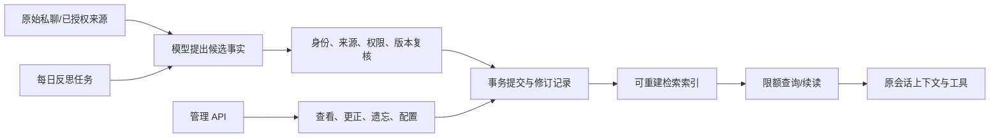

# Memory 拓展实现记录（2026-09-23）

当前交付是私聊记忆核心闭环，尚未完整接替 V1 的记忆能力。[V1 专项对照检查](CORE_MEMORY_V1_PARITY_AUDIT_20260923.md)区分已覆盖、由新方案或其他领域承接，以及仍需补齐的使用链。

2026-09-24 增补已合入：[私聊记忆完善切片](CORE_MEMORY_PRIVATE_POLISH_20260924.md)新增常驻置顶、可信 Bot 回复原文、凭据脱敏、事实修订查询与批量清理，主树受影响回归 115 项通过。此项与下文原始 263 项记录分别记账，不累加为覆盖率。

## 目标与接入位置

记忆拓展是 V2 统一宿主中的独立领域，不另建插件进程或第二套身份/配置/任务系统。数据属于当前通过认证的人类主体，并绑定安装、Bot 与角色；durable 记忆可在同一主体的其他私聊窗口复用，session retention 仍绑定原完整 scope。管理员只提供管理身份，不能替代记忆主体。实现位于 `companion_v2/memory/`，AstrBot Dashboard 适配位于 `astrbot_host/memory_api.py`。

## 已落地能力

- 事实与证据：提案/提交分离；提交时重验主体、作用域、授权来源、内容哈希、版本和幂等键；支持 CAS、修订、冲突保护和来源依赖。
- 忘记与重建：以逻辑遗忘使记录退出召回；派生经历/视图保留原始来源依赖，可随来源撤回失效；检索索引可从权威记录重建。
- 查询与对话：查询按项数、字符数、回合和次数限额；证据先固化到原批次，再在生成/续读时复核；记忆工具使用原角色与原会话权限。
- 生活经验：对有依据的事实、经历摘要和对象导航提供独立记录；每日反思使用增量输入、持久任务和重复安全提交，不按对话次数晋升为事实。
- 管理与配置：Dashboard HTTP API 支持列表、单条更正/撤回/遗忘、置顶/取消置顶、授权历史版本查询、私聊事实库清理预览及幂等执行、记忆配置；管理操作者与被管理主体分开校验，个人配置走 V2 统一字段注册和 CAS。Memory 事实管理完整页面和独立候选采用管理入口尚未接入。
- 宿主：和日记、主动联系、提醒、关系上下文共享原任务、模型路由、存储和生命周期；管理路由由宿主统一注册/注销。

## 版本与兼容

主树已有 v19→v20 迁移用于 `proactive_contacts`，其 SQL、迁移 ID 和指纹保持原样。记忆表使用新的 v20→v21 迁移；升级顺序为 v19→v20→v21。迁移回滚与重开由临时 SQLite 仓库验证，未读写 V1 数据。

## 验收

使用 AstrBot 自带 Python，在临时测试根下运行记忆写入/查询/边界/对话/经历/管理/反思、Dashboard API、存储升级、宿主/路由、日记/角色生活、主动联系、后台历史、关系记忆与来源测试。并入开放事项与 staging 生命周期/路由回归后，主树定向测试共 **263 项通过**。回归曾发现开放事项快照校验缺少对外委托方法，造成普通回复在模型调用前失败；现已补齐并由宿主生命周期测试覆盖。测试未连接线上平台或读取 V1 用户数据。

## 仍未覆盖

上述 263 项是实现批次的内部集成证据，不是 V1 全功能对等验收；后续专项对照检查源码和已有测试，未重复执行这批测试。

- 群聊公共记忆及群成员可见性策略尚未实现；当前只允许同一主体、Bot 与角色之间按授权跨私聊窗口投影。
- 稳定跨拓展 `memory.*.v1` 合同尚未全面启用；已有[只读查询适配及进程内 provider 注册切片](CORE_MEMORY_QUERY_WIRE_SLICE_20260924.md)，写入、查询操作回执、订阅/resync 和跨进程稳定 SDK 仍待完善。
- 每轮常驻核心记忆已接入独立的 `context_mode` 与预算；自动 Embedding provider、完整重排与去重复召回尚未接入，目前仍是相关事实自动查询和显式向量检索底座。
- Memory 原文查询和反思选材已纳入有 delivered 回执的 Bot 回复，新增写入链已有统一常见凭据清洗；全量历史存储清洗、媒体元数据和其他领域来源适配仍待单独验收。
- 事实、原文与经历查询目前读取该主体的全部匹配记录后再排名、分页；返回量和调用预算有界，不代表底层扫描量有界。增量索引与大规模容量仍待改造和验收。
- 当前宿主私聊关系的事实及修订已有批量清理预览/执行和授权历史查询；跨领域“忘记我”、群/群成员清理、历史导入导出、冷归档恢复及多领域适配尚未完整接替 V1。内部 v21 建表不等于旧数据迁移。
- 忘记提供权威 V2 记录的逻辑遗忘，不承诺擦除宿主日志、外部模型记录或已有备份。
- 真实模型语义质量与正式线上群聊/私聊验收未在此轮执行；本轮只验证合成环境和结构/权限行为。
