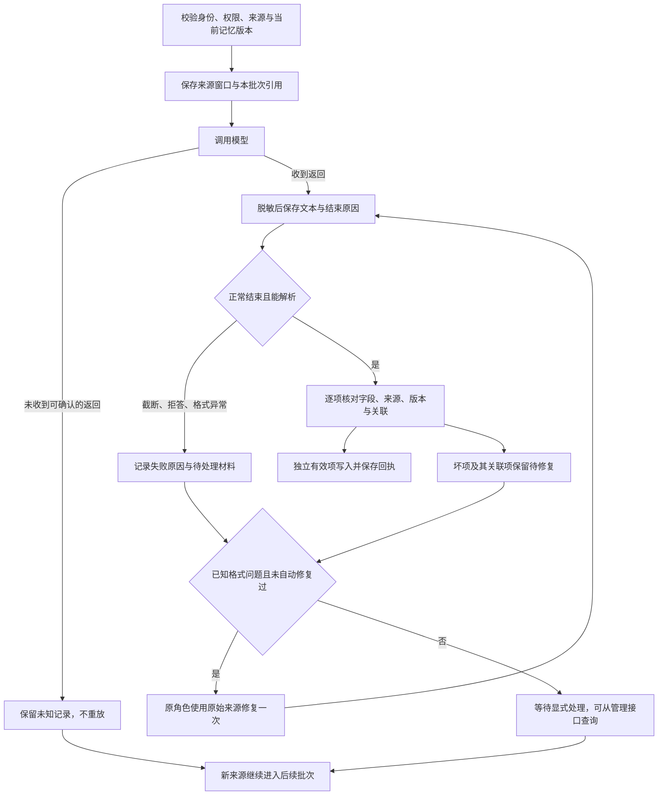

# V2 记忆输出容错与恢复

本切片解决“模型已返回，但 JSON 不合规导致新记忆未保存，且后续每日整理被阻塞”的问题。代码已接入 V2 主树的记忆反思、AstrBot 模型适配、统一配置、持久调度和认证管理 API；不操作 V1 数据或在线实例。

后续[恢复队列与连续整理切片](CORE_MEMORY_RECOVERY_QUEUE_20260924.md)补齐 prepared/pending 材料占用、日程更新后的显式修复、政策版本刷新、未调用模型的过期任务恢复及管理分页；本记录末尾的 185 项仍为原切片验收范围，不与后续计数累加。

## 原因与改动

旧路径在 AstrBot 适配层直接解析 JSON，错误被归入调用 unknown；即使传到记忆领域，一条坏提案也会让整批尚未写入的正确提案一起失败。失败返回没有独立的持久检查点，日程 pending_batch 又会反复指向同一批次。

现在模型“已返回”与记忆“已保存”分别记账。`CapturedModelOutput` 只用于宿主选定的 `memory_reflection` 输出，不能进入普通回复、工具执行或其他私有书写通道。模型账本的 generated 表示收到返回，不表示记忆校验或写入成功；实际记忆状态看反思与条目回执。已有前台和日记输出合同保持原语义。

自动修复最多增加一次模型调用，仍使用共享任务名额、原模型预算与原角色复核。未知请求、拒答、权限或来源问题不会触发自动修复。自动修复失败后，原返回和失败原因继续保留。

## 输出减负

- 新提案直接写在 proposals 数组中，宿主分配 item_id；兼容旧 item_id/proposal 包装。
- 来源使用 s1、s2 等本批次短引用，纠正目标使用 f1、f2 等事实引用。引用与完整证据片段、事实 ID/revision 一起持久保存，不依赖临时查询会话续期。
- 常用字段为 operation、evidence_handles、predicate、object、representation、target。只有确实存在额外语义时才填写 details；条件、例外、否定和第三方归因仍要保留。
- 身份、权限、命名空间和幂等操作键由宿主提供。修复中的旧事实引用不会重新绑定到另一个事实或新版本。
- 新提示协议提供精简示例、空结果示例约定及修复要求。模型输出仍是候选资料，不能仅凭“已记住”的表述证明落库。

## 解析、部分保存与恢复

只自动去除完整、唯一的外层 Markdown 代码围栏。不截取第一对大括号，不补全截断 JSON，不选择重复键，不猜来源、身份或版本。无穷数、异常 Unicode、过长整数、重复对象和额外说明保留为明确的格式失败。

提案在整体 JSON 可解析后逐项校验。独立有效项可以先保存；涉及同一事实或纠正目标的坏项会连同关联项一起保留。不明依赖的坏项保守保留整组；重复条目编号视为无法可靠关联回执的批次错误。对同一事实同时接受旧 pending 提案并重复 add，会阻止该组写入。

原返回写入现有 `memory_reflections.result_json.raw_output`，正常结果、错误码、未完成项和修复关系也保存在该记录中；逐项写入仍有 `receipts_json` 回执。本次没有新增数据库表或修改已发布的 schema 迁移指纹。旧 modelled/complete 记录仍可读取和恢复。

重启后，received 可以直接继续解析，modelled 可以直接继续原写入。每次恢复重新核对现行权限、来源撤回/遗忘状态和记忆版本。来源或版本已变化时保留材料并转为待处理，不让旧分析覆盖新纠正。

部分修复只接收原未完成项的编号。修复模型额外输出已完成项也不能扩张下一轮修复范围。重复操作键复用原批次、任务与回执；不会新增一次生成或一次事实写入。格式修复成功后向原批次回填完成状态，失败历史仍保留。

脱敏覆盖新保存的返回文本、转义后的常见凭据字符串及已识别的凭据事实值。管理接口不返回 raw_output 或待修复正文。它是受权限保护的恢复材料，不进入检索事实库；这不等于通用秘密识别或全域物理擦除。

## 调度与状态

| 状态 | 含义与处理 |
| --- | --- |
| prepared | 待执行的原任务 |
| running | 尚无持久可确认返回；不得重复调用 |
| received | 返回已保存，可继续本地解析 |
| modelled | 校验结果已保存，可继续原写入 |
| failed | 已知失败；错误码和已有材料保留 |
| partial | 部分条目已保存，其余待处理 |
| complete | 此批次及已关联修复处理完成；具体事实以条目回执为准 |
| empty | 本批次没有可整理材料；deferred_sources 仍可表明旧批次未解决 |

失败或未知批次保留在反思记录中，日程解除对该批次的独占等待。下一批会跳过这些批次已占用的原来源，继续处理新材料。`covered_until` 不会跨过未处理范围；`deferred_sources` 表示暂时保留在旧批次的来源数，不等同于丢弃。暂停日程、关闭记忆或撤销来源仍阻止新写入。

## 配置与管理入口

通过已有认证的 memory/settings 与 memory/settings/command 管理同一份后台配置，新增：

- `memory.reflection_auto_repair`：默认 true，已知格式失败最多自动修复一次；关闭后仍保留材料及显式修复入口。
- `memory.reflection_response_format`：默认 text，兼容原有提供商；确认服务支持后可选择 json_object 或 json_schema。后者实际发送 `response_format.json_schema` 和 `strict=true`，不是只在提示词里粘贴 schema。不自动探测或轮换提供商重试。

路由前缀为 `/astrbot_plugin_private_companion_v2/memory`：

- `GET /reflections?limit=20`：查看当前管理范围的未完成末端批次；返回状态、固定错误码、条目回执、是否可恢复/重试、has_more 和 next_cursor。续页使用 `after_id=next_cursor`；已转交子修复的父批次不重复占据队列列表。
- `GET /reflections?batch_id=...`：核对指定原批次或修复批次；正文只在原资料仍可读时提供。
- `POST /reflections/retry`，正文为 `{"batch_id":"原批次 ID","operation_key":"本次操作的稳定唯一键"}`：恢复 received/modelled/prepared 原批次，或为已知失败创建关联修复。相同操作键可以安全重发。running/未知批次不允许重放。

以上入口要求已认证 Dashboard 核心操作者；目标人、角色与会话来自已加载的宿主配置，不能由请求正文冒充。停机和来源撤回不受长时间模型调用阻塞。该切片交付管理 HTTP API，尚未增加独立的可视化事实/修复页面。

## 验证与边界

使用 AstrBot 自带 Python、模拟模型/发送器和临时数据库验证。新增故障注入覆盖代码围栏、无效 JSON、重复字段、异常数字/Unicode、输出截断、凭据脱敏、一次自动修复、独立项保存、关联项隔离、修复范围不扩张、同键重放、重启后恢复、来源撤回、并发事实变更、每日失败后继续处理新来源，以及认证管理 API 从失败到修复的完整通路。

同时回归受影响的模型网关、原生适配、记忆反思/上下文、原角色工具、日记书写、宿主启动与路由注销。最终测试结果以本记录末尾的验收结果为准。

没有发起真实模型或 QQ 调用，没有重载在线插件，没有访问或迁移 V1 用户数据。提供商严格 schema 的实际兼容性与真实模型记忆提取质量仍需各服务验收。旧版本从未保存的模型返回无法凭空恢复，历史 unknown 也不会自动改判成可重试。

### 最终验收结果

受影响范围按测试 ID 去重共 **185 项**，最终每项都有通过记录。本次新增 24 项用例；不是整个仓库的完整回归，也不表示整个 V2 或真实提供商已验收。

- 首轮组合回归 183 项，182 通过，已有的会话批次顺序测试超过其 3 秒等待时限；包含该测试的宿主/原生适配 35 项子集单独复验全部通过，未放宽其等待上限。
- 随后的记忆与接口 36 项回归发现管理重试完成后的回执关联不一致，已修复；管理 API 与恢复重放 7 项复验全部通过。
- 增补的旧 modelled 记录兼容用例通过，撤回/暂停/未知调用的最后 3 项复验通过。新返回类型、schema 请求及其输入预算、语义来源校验与原角色输出均在上述范围内。
- 交付文件均通过 UTF-8、无 BOM、LF、末尾换行检查；Python 文件通过 AST 语法检查。

测试模块为 `test_memory_recovery`、`test_astrbot_memory_output`、`test_memory_reflection`、`test_memory_host_api`、`test_astrbot_model_wire`、`test_model_gateway`、`test_model_failures`、`test_memory_polish`、`test_memory_boundaries`、`test_memory_conversation`、`test_role_tool_loop`、`test_role_journal_writing`、`test_host_application`、`test_astrbot_staging_host`。宿主测试设置进程 `PYTHONPATH=C:/Users/99505/.astrbot/backend/app`，并由测试夹具设置临时 AstrBot 数据根。

本机验收证据保存在 `C:/Users/99505/.codex/workspaces/v2-memory-recovery-q87kbl8c/`：`validation.log`、`validation-followup.log`、`validation-final.log`、`validation-api-final.log`、`validation-legacy.log`、`validation-fences.log`，以及去重用例清单 `test-inventory.json` 和文件 SHA-256 清单 `delivery-manifest.json`。失败记录保留，后续通过记录对应上述修复。
