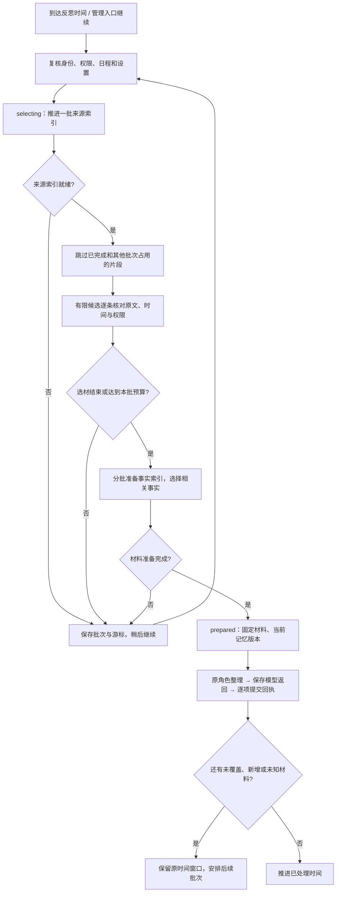

# V2 记忆反思：分批准备、材料占用与后台续接

日期：2026-09-24。接续[来源、经历与混合增量召回](CORE_MEMORY_MIXED_RECALL_20260924.md)，本批完成后台反思准备链的全量正文读取优化。代码已落入 V2 主树，验收使用独立临时数据根、合成资料和本地模型替身；没有在线重载、真实模型/QQ 调用或 V1 用户数据访问。

## 已落地行为

原先每次 `prepare()` 都会遍历历史完成批次、读取全部来源、遍历未完成批次以找占用，再逐个读取所有活跃事实以统计数量。现在先通过增量投影和持久占用索引筛选候选，再读取本轮候选的原件。



- `selecting` 是持久状态。保存准备阶段、来源游标、已选证据、来源版本锚点和预算；重启继续同一个批次。
- 来源投影默认每步最多处理 256 个变更/片段，选材最多复核 128 个候选。本批证据仍遵守原有条数和字数预算；相关事实最多展示 8 条。已有证据的复核也受本批预算约束。
- 冷索引或缓存忙时保留材料和占用；尚未准备好时没有模型任务。缓存错误以 `selection.blocked_code` 返回，可以继续原批次。
- 日程遇到 `selecting` 保留 `pending_batch`，一秒后再推进。启动恢复只修复本地状态和唤醒时间，不在恢复扫描中调用模型。
- 自动修复与显式修复都支持分批准备。修复沿用父批次原材料和未完成项，不能扩大范围，也不重放已保存项或未知模型调用。
- 同一批次在管理入口可继续，返回准备阶段、已检查候选数量、阻塞原因和可续接状态。

## 主库与缓存

V2 主库由 v26 升至 **v27**。新增 `memory_reflection_inputs`，维护三种关系：原文片段、待处理提案、提案引用的证据。它保存身份与片段指纹，不复制原文。

占用记录由插入/更新触发器随原批次事务维护；状态变化通过关联原批次实时判断。外层事务回滚不会留下独立占用记录。升级在一次事务中回填既有批次，校验升级回执、表结构、索引和触发器；失败整体回滚。回填旧 manifests 仍有一次性扫描成本，这不是每次反思的热路径。

缓存 format 升至 **3**，来源投影版本升至 **2**，补充片段身份和时间排序索引。旧来源投影会分批重建，索引内向量可能需要重新附着；主库事实、原文和反思回执不因此丢失。

缓存连接以只读方式附加主库，仅查询已提交的占用关系进行预筛选。返回候选后仍在当前主库连接复核占用，再从来源 owner 读取原件；外层事务尚未提交的占用也不能绕过。该附加连接不授予原文读取权限，且在主库事务提交前关闭。

片段键包含来源 owner/ID、版本、区间、片段哈希和说话者归因。Bot 已脱敏回复首次发布前后的治理内容哈希不参与此键；真正传给模型的证据仍核对正式来源及其内容哈希。中文 ID 的 Python 编码与 SQLite 编码一致。

## 覆盖范围与并发

来源扫描结束后固定本轮材料快照。事实准备或模型运行期间若来源版本锚点发生变化，`continuation_needed=true`，本轮可以完成，但日程不会把原窗口标成全部处理；一分钟后安排下一批。`remaining_sources=null` 表示未知，不能视为零。旧版批次缺少锚点时采用相同的保守处理。

源材料是否位于窗口内，以正本消息时间再次核对；缓存时间不能把窗口外资料带进来。无法读取的候选会推进游标并记录 `unavailable_sources`，不会当作已经完整覆盖。其他批次占用用 `deferred_sources` 表示。只要仍有未覆盖、占用、不可用或未知范围，便不推进 `covered_until`。

同一来源的重复投影不会在本批重复选入；长消息按片段位置接续。待处理提案先在 SQL 中排除已被其他批次占用的项，再取前 32 条，后方积压不会被已占用的第一页一直挡住。

游标只随当前来源分区的历史版本或重建代次重置。其他关系更新缓存的全局 epoch 不会使本轮重新检查已跳过的候选。

暂停日程、变更配置、撤回已选原文或撤销权限都会在继续准备及模型派发前重新校验；已知材料失效进入待处理失败状态。相关事实是有限召回结果，`fact_selection_complete` 保留召回完整性；活跃事实数量采用目录计数，`fact_count_basis=active_heads_not_individually_read`，不表示逐个读过或全部可读。提示词明确要求不要把未选中、未读到或计数未知解释为不存在。

## 验证与性能

新增 **29 项**：核心选材及迁移 21 项、真实本地宿主装配与替身 provider 8 项。覆盖冷启动分批、缓存忙、未提交占用、外层回滚、长文接续、中文键、超过一页的提案、原文时间复核、撤权/撤回、原批次重启、日程暂停、自动/显式修复、未知覆盖、新增来源以及其他分区更新期间的游标推进。

最终四份回归日志按测试 ID 去重 **249 项全部通过**。记录如下，重复执行不累计数量：

| 验证批次 | 结果 |
| --- | --- |
| 反思、恢复、队列、启动恢复与选材 | 87 项通过，见 `reflection-final.log` |
| 查询、来源/经历/混合召回、事实增量、写入、边界和 pending wire | 124 项通过 |
| 数据库历史升级、执行存储与存储隔离 | 38 项通过，见 `schema-final.log` |
| 最终选材与宿主集成 | 29 项通过；已包含于上述 87 项，不重复累计 |

较早批次另有 **22 项** SDK 管理宿主加载/停机/路由注销及记忆 API 测试通过，保留在 `schema-sdk-regression.log`，不计入此次最终四份日志的统计。SDK 测试使用 AstrBot 自带 Python 和临时 `ASTRBOT_ROOT`。

初次并行回归中，`test_repeated_format_failure_is_bounded_and_never_becomes_empty` 在对话夹具准备阶段超时，尚未进入反思操作；独立复查和最终 87 项回归均通过。保留原失败日志，没有放宽该测试超时或屏蔽断言。

性能夹具包括 1000 条来源、128 条活跃事实、600 个完成反思批次及 200 个占用批次，每轮选择 4 条来源。通过动态加载本轮修改前的反思实现进行同机比较，不回滚共享代码树。最终运行记录：

| 指标 | 原准备实现 | 分批准备实现 |
| --- | ---: | ---: |
| 热准备耗时，3 次中位数 | 906.3 ms | 74.6 ms |
| 冷准备总耗时 | 917.2 ms | 324.3 ms |
| 冷准备步数 | 1 | 4 |
| 冷准备最长一步 | 917.2 ms | 142.5 ms |
| 热准备来源鉴权读取次数，含重复复核 | 1148 | 32 |
| 热准备事实正本读取次数 | 136 | 8 |
| 每次准备全历史 manifest 扫描 SQL 条数 | 2 | 0 |

两种实现均选出 4 条，报告剩余候选 196、其他批次占用 200。优化后的冷步骤依次投影 256、256、256、232 个来源对象；热路径无新增来源投影。耗时包含计数探针，受本机共享负载影响，不作为线上延时承诺。第一次采样为 777.7 → 64.5 ms，最终代码复测为上表数值，原件读取数量一致。

**本批消除的是每次准备的全量正文读取、历史 manifest 解码以及逐事实鉴权计数。** SQL `COUNT`、反连接、FTS 排序与主库锁等待仍受数据规模影响；单条来源很长时读取原件的成本也仍存在。本批没有宣称所有数据库扫描、冷建总成本或事件循环停顿都已消失。

## 文件与复现

- `companion_v2/memory/reflection_selection.py`：准备状态推进、来源候选与覆盖锚点。
- `companion_v2/memory/reflection_inputs.py`：片段键及当前事务占用复核。
- `companion_v2/storage/reflection_schema.py`、`schema.py`、`runtime.py`：v27 占用表、事务触发器和升级。
- `reflection.py`、`reflection_recovery.py`、`reflection_management.py`、`scheduling.py`、`checkpoints.py`：原角色调用、修复、管理与后台续接。
- `search.py`、`recall_index.py`、`recall_objects.py`、`writer.py`、`prompts.py`：缓存候选、原文投影、待处理提案筛选及未覆盖说明。
- `tests/test_memory_selection.py`、`tests/test_memory_selection_host.py`：本批新增测试。
- `tools/benchmark_memory_selection.py`：可重复合成性能夹具。

在 V2 工程根目录执行：

```powershell
& 'C:/Users/99505/.astrbot/backend/python/python.exe' -X utf8 -m unittest -v tests.test_memory_selection tests.test_memory_selection_host

& 'C:/Users/99505/.astrbot/backend/python/python.exe' -X utf8 -m tools.benchmark_memory_selection `
  --baseline-memory D:/codex/workspaces/v2-memory-selection-ztsxo4ii/before/companion_v2/memory `
  --output D:/codex/workspaces/v2-memory-selection-ztsxo4ii/performance-recheck.json
```

证据目录：`D:/codex/workspaces/v2-memory-selection-ztsxo4ii/`。包含修改前后快照、测试日志及按 ID 汇总、两次性能记录、局部 diff、UTF-8/LF/AST 检查和 SHA-256 manifest。`BUILD_STATUS.md` 是共享进度文件，保留其他窗口内容，单独快照，不把其中其他窗口的新增条目计入本批代码 diff。

后续可针对更大数据量优化 SQL 候选计数、排序和主库锁等待；群记忆的受众/来源合同与管理页面进度展示仍属各自后续切片，不由本次私聊反思优化代替。
