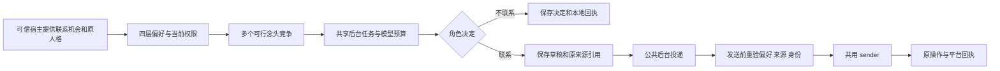

# CORE-06 主动联系偏好与执行链

日期：2026-09-23。已把持久联系偏好、临时暂停、免打扰、原角色生成和公共投递接入 `CompanionApplication`。本批以临时 V2 数据、替身模型和发送器验证，不启动在线 profile，不发送平台消息。

后续已补齐[首批自动联系机会、独立额度与后台历史接续](CORE_AUTOMATIC_CONTACT_AND_HISTORY_SLICE.md)。下文保留显式机会切片的原始范围与测试证据；当前功能边界以两份记录共同说明。

## 已接通的链路



`application.proactive.contact(context, opportunity, intents, role_instruction=..., selection_seed=...)` 是可信生产者入口。机会保留完整原 scope、开放时间和截止时间；同一 scope/机会 ID 只产生一个生成任务，原请求重放返回原任务，换正文、人格、时限或授权不能复用它。原切片由宿主显式提供机会；后续自动调度也通过该入口提交已复核原私聊与人格的当前时段机会，未回应或模型输出本身不产生新触发。

候选采用 `ContactIntent(purpose, thought)`。普通文字联系支持受治理的文本 Source；图片、附件及分享物的投递仍需对应领域 owner，不在此入口伪装成一条文本发送。念头摘要是意向，不是可直接发送的正文。模型请求使用明确的 `BackgroundPromptTrigger`，不会伪装成新的用户发言，也不会生成虚构的用户消息来源。

`proactive.compose` 使用显式后台 `ModelTaskProfile` 和公共网关。缺少该 profile 会拒绝调用，不回落到前台模型。AstrBot staging 装配已登记独立联系 profile，实际启用和发送仍受原宿主状态、配置、预算与平台授权约束。

## 偏好和暂停

公共 `ConfigurationService` 的 `proactive.contact` 分组是唯一配置正本。领域 owner 复用 `configuration_targets/values`、CAS、原操作回执、来源追溯、reset 和采用回执，没有另存一份设置。

继承顺序是安装 → Bot 下的角色 → 角色与真实用户的关系 → 完整私聊窗口，逐字段解析。关系键包含安装、Bot、角色、Human；窗口再包含账号、会话和 session。原来不带 subject 的配置地址和默认三级继承保持原键。主动分组要求显式 Bot，窗口还必须带已登记的真实用户，拒绝创建消费者无法读取的另一套窗口设置。

关系偏好仅本人或 core 管理者可访问；standard 还需精确作用域的配置授权。窗口 subject 必须等于可信路由登记的用户。消费时再由公共 TaskSupervisor 复核原账号绑定、完整私聊、角色绑定版本和受众，不能用配置开关授予行动权限。

字段均带 `proactive.contact.` 前缀：

| 字段 | 语义 |
| --- | --- |
| `enabled` | 普通主动联系总开关，默认关闭。 |
| `note` | 提供给原角色的联系偏好补充，显式空文本与继承有区别。 |
| `pause_until` | 带时区的临时暂停截止时间，空文本表示本层没有暂停。 |
| `quiet_enabled`、`quiet_start`、`quiet_end`、`quiet_timezone` | 明确的免打扰；当地 HH:MM，含起点、不含终点，跨午夜可用，起止相同表示全天。 |
| `<purpose>.enabled`、`<purpose>.weight`、`<purpose>.pause_until` | 各联系目的的开关、竞争权重和临时暂停。 |

13 类目的为亲近、关怀、互动、修复、日常话题、问候、角色生活、作品/阅读、资讯、接回旧话题、活动邀请、普通提醒、环境变化。权重只用于多个可行念头之间的竞争，不表示触发概率、采集频率或预算；只有一个可行念头时不用权重。

普通字段允许下层显式覆盖，`false`、空文本和 reset 互不混淆。暂停单独保存截止时间，不改写永久开关。各层仍生效的暂停共同约束联系，取最晚截止时间并保留其来源；下层清空自己的暂停不能绕过上层暂停。到期按当前时间自动恢复永久偏好，无需定时写回数据库。配置 preview 也显示实际生效的上层暂停。

联系暂停只被主动联系消费者读取；日记、阅读、角色生活和已接受的 Agenda 提醒不依赖此开关。`reminder` 目的只是普通主动念头，不能吞掉此前接受的预约。

## 生成、取消和真实效果

选择前先检查偏好和来源可读性。文本来源必须仍有效、属于完整原窗口、包含原受众，且当前身份具有该窗口的 `text` 读取授权。读取内容哈希在选择后固定，生成与发送再次核对。原来源正文不复制进联系记录；生成文本保存在独立领域表，不发布成事实 Source，也不写入关系记忆。

提示词保留原人格，明确区分意向、对方自述、计划、创作、梦和真实活动；未回应不能推断用户在忙、生气或疏远。模型可输出 `send` 或 `skip`，语义判断不靠关键词封锁。程序只验证输出结构、真实权限和外部效果。

`skip` 保存一次明确的不联系决定及本地操作回执，不创建消息任务。`send` 在同一事务中保存草稿、原件引用、偏好 token、生成用量引用、本地回执和公共投递任务；队列满等提交失败会整体回滚，已用模型额度仍记账。原机会不自动重新生成。

生成进行中、生成完成时、队列领取和 sender 的真实效果边界均检查当前偏好。暂停、进入免打扰、来源撤回、文本变更或角色/账号换绑会丢弃旧稿或阻止发送；保留实际模型用量。旧稿一旦失效不会在暂停结束后自动恢复，新的可信机会可按届时偏好执行。

`observe(context, task_id)` 返回任务、明确跳过、公共投递状态和回执引用，不返回私人正文；本地草稿已保存、平台 accepted 和 delivered 分别记账。`cancel(context, task_id, expected_revision=...)` 通过原任务 CAS 取消生成及关联投递。已派发后的不确定结果保留 unknown，迟到原回执仍能核账，不重发。

宿主启动恢复公共任务和未派发投递；已经完成的联系决定不会再调用模型，未派发草稿保留原截止时间和原 sender。停机纳入联系调用与模型 worker 的句柄，实际未停止时不关闭数据库或释放名额。

公共后台投递结果位于 `background_deliveries/receipts`，原 `conversation_sent_history` 保留前台分段合同。[后续切片](CORE_AUTOMATIC_CONTACT_AND_HISTORY_SLICE.md)已通过独立投影接入主动与普通回复上下文，并增加私聊空闲机会、未回应背景和窗口联系额度；公共模型预算、前后台名额与宿主生命周期继续共用。

## 存储与验证

内部 schema v19 → v20 新增 `proactive_contacts`，保存联系决定、生成文本及原操作引用。旧版本升级保留历史指纹，迁移中校验表结构与完整性；失败回滚，部分未来表或篡改的迁移回执拒绝打开。仅升级合成临时 V2 数据，没有读取 V1 用户数据或升级在线库。

本批新增 43 项测试，覆盖四层继承、权限隔离、暂停/免打扰、CAS/幂等、模型决定、来源撤回、预算耗尽、投递队列回滚、停机、重启与迟到回执，并补充极大有限权重的数值稳定性。

相关定向验证按测试 ID 去重共 **415 项通过**：存储 88 项，配置/诊断/主动链 119 项，宿主/SDK 145 项，角色生活与日记共存 75 项；其中 12 项偏好测试出现在两个分组中，不重复计数。另有 34 个涉及文件通过 UTF-8、无 BOM、LF 和 Python 语法检查。

主要验证命令：

```powershell
$env:PYTHONPATH = 'C:/Users/99505/.astrbot/backend/app'
& 'C:/Users/99505/.astrbot/backend/python/python.exe' -X utf8 -m unittest tests.test_proactive_preferences tests.test_proactive_contacts tests.test_proactive_contact_storage tests.test_proactive_sharing -q
& 'C:/Users/99505/.astrbot/backend/python/python.exe' -X utf8 -m unittest tests.test_configuration tests.test_capability_configuration tests.test_management_access tests.test_diagnostics tests.test_diagnostic_repairs tests.test_diagnostic_tools -q
& 'C:/Users/99505/.astrbot/backend/python/python.exe' -X utf8 -m unittest discover -s tests -p 'test_*storage*.py' -q
& 'C:/Users/99505/.astrbot/backend/python/python.exe' -X utf8 -m unittest tests.test_host_application tests.test_host_recovery tests.test_host_external_tools tests.test_agenda_background tests.test_astrbot_staging tests.test_astrbot_staging_config tests.test_astrbot_staging_host tests.test_astrbot_staging_bootstrap tests.test_astrbot_model_wire tests.test_astrbot_native tests.test_isolation -q
& 'C:/Users/99505/.astrbot/backend/python/python.exe' -X utf8 -m unittest tests.test_role_journal_host tests.test_role_journal_writing tests.test_role_journal_triggers tests.test_role_journal_scheduling tests.test_role_life_host tests.test_role_life_runtime tests.test_role_life_api -q
```

测试包括 SDK 加载、停机与路由注销；所有模型、平台发送都使用替身。这里的测试证据证明本地合同与集成，不代替未来自动触发和线上运行验收。
